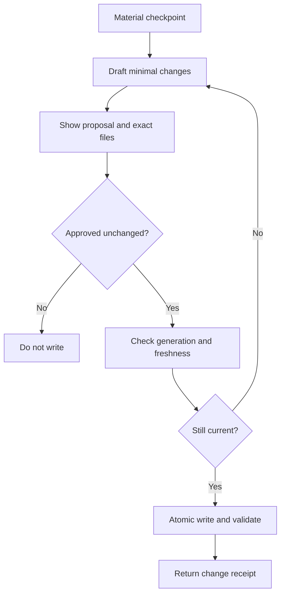
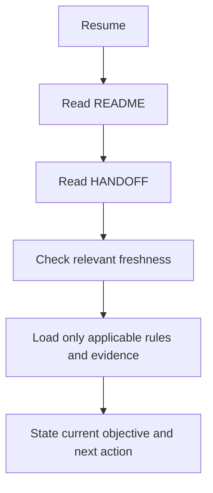
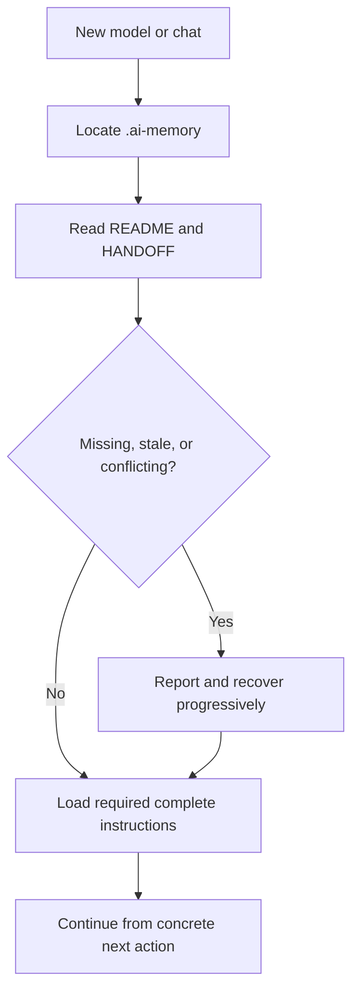

# Handoff protocol

`HANDOFF.md` contains exactly one replaceable active task. It is not a task
archive. When no task is active, retain the idle skeleton.

## Task receipt

At task start, prepare:

- **User request:** the user's request corrected for spelling and grammar while
  preserving scope and intent;
- **Task understood:** a concise operational interpretation;
- **Plan:** the next few bounded steps;
- **Skills or capabilities:** selected packages and why;
- **Mode:** active modes and whether they are chat-scoped;
- **Boundaries:** explicit exclusions, approval gates, and working root.

Show the receipt to the user. Any HANDOFF write still follows the separate
change-review approval protocol.

## Active checkpoint

Store the minimum continuation state:

- objective and current phase;
- constraints and accepted decisions with rationale;
- active working root and relevant revisions;
- completed effects, separate from attempted work;
- verification performed, evidence pointers, and known limitations;
- selected skills or modes still relevant;
- unresolved issues and blockers;
- one concrete next action.

Never label implementation complete because a plan exists, or verified because
a command was attempted. A completed external effect should have a compact
receipt sufficient to avoid accidental repetition, but the receipt grants no
future authority.

## Flow by situation

- **Same thread:** refresh only after a material change; do not rewrite on every
  message.
- **Compaction recovery:** reread the project front door and active handoff,
  then reload complete relevant instructions when retention is uncertain.
- **New thread or model:** read front door, handoff, relevant freshness, then
  only the linked rules and artifacts needed for the next action.
- **Completion:** propose lasting knowledge for `README.md` or `rules/`, record
  final verification accurately, then propose clearing HANDOFF to idle.

## Flowcharts

---

[⌂ Home](../README.md) · [Topic index](../INDEX.md)
